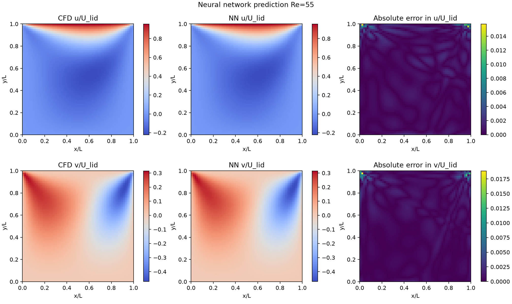
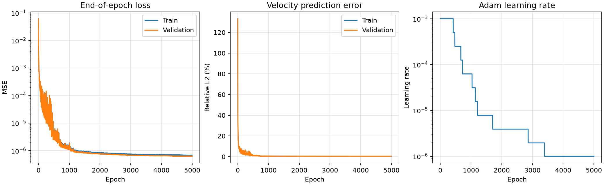

# Cavity Surrogate

A small, reproducible CFD-to-machine-learning project for **two-dimensional steady lid-driven cavity flow**. OpenFOAM generates reference velocity fields, and a PhysicsNeMo/PyTorch multilayer perceptron (MLP) learns the mapping

$$
(x/L,\; y/L,\; Re) \longrightarrow (u/U_{\mathrm{lid}},\; v/U_{\mathrm{lid}}).
$$

The project covers CFD data generation, numerical sensitivity checks, case-level data splitting, neural-network training, and comparison with a piecewise linear interpolation baseline.

**Main result:** on four held-out Reynolds numbers, the MLP achieves **0.41%–0.52% relative L2 error** against the CFD data. Linear interpolation is more accurate for this densely sampled, single-parameter problem, achieving **0.019%–0.043%**.

## Physical setup

| Property | Configuration |
|---|---|
| Flow | Incompressible, steady laminar lid-driven cavity |
| Solver | OpenFOAM Foundation 13, `foamRun` with `incompressibleFluid` |
| Geometry | Square cavity, side length `L = 0.1 m` |
| Lid speed | `U_lid = 1 m/s` |
| Boundaries | Moving top wall; stationary no-slip side and bottom walls; empty front/back patches |
| Parameter | `Re = U_lid * L / nu`, varied through kinematic viscosity |
| Dataset grid | Uniform `64 × 64 × 1`, 4,096 cell centers per case |
| Parameter range | `50 ≤ Re ≤ 200` |
| Simulation time step | `deltaT = 0.0005 s` |
| Exported snapshot | `t = 10 s`, after temporal screening |

This is a **supervised CFD surrogate**, using velocity-label MSE. It does not include PDE-residual losses, pressure prediction, or transient prediction.

## Dataset and model

The dataset contains **24 complete CFD cases**. Splits are assigned by Reynolds number, rather than by randomly splitting points from the same flow field.

| Split | Cases | Reynolds numbers |
|---|---:|---|
| Train | 16 | 50, 60, 70, …, 200 |
| Validation | 4 | 65, 105, 145, 185 |
| Test | 4 | 55, 95, 135, 175 |

Each exported `.npz` contains `inputs` of shape `(4096, 3)`, `targets` of shape `(4096, 2)`, and metadata including Re, viscosity, grid size, physical scales, snapshot time, and split. Inputs store dimensionless coordinates and the nominal Re. The dataset index also records `nu_actual` and `Re_actual` to preserve small legacy dictionary-rounding differences.

Network inputs are transformed as follows:

$$
\tilde{x}=2x/L-1,\qquad
\tilde{y}=2y/L-1,\qquad
\widetilde{Re}=2\frac{Re-50}{200-50}-1.
$$

Velocity targets are already divided by the lid speed and receive no further scaling.

The default model uses **four hidden layers of width 64**, `tanh` activations, and two velocity outputs. Training uses Adam, batch size 1,024, an initial learning rate of 0.001, and `ReduceLROnPlateau`.

In multi-case training, **one shared best model** is selected using aggregate MSE across all validation points. Test velocity fields are not loaded during training.

## Setup

The recorded environment uses Ubuntu 24.04, Python 3.12.3, PyTorch 2.7.1 with CUDA 12.6, and PhysicsNeMo 1.3.0. See [the environment snapshot](docs/environment.md) and [dependency lock](docs/requirements-lock.txt).

Run commands from the repository root:

```bash
git clone https://github.com/huiyuxie/cavity-surrogate.git
cd cavity-surrogate
python3 -m venv .venv
source .venv/bin/activate
python3 -m pip install --upgrade pip
python3 -m pip install -r docs/requirements-lock.txt \
  --extra-index-url https://download.pytorch.org/whl/cu126
```

The lock describes the recorded CUDA environment. The scripts can execute on CPU with `--device cpu`; GPU execution uses `--device cuda`. Keep PhysicsNeMo at the recorded version for the model API used here.

OpenFOAM is required only to regenerate CFD data or repeat CFD checks. The committed exported dataset can be used directly for ML training and evaluation.

## Quick start: evaluate the saved model

Predict Re55 using the committed GPU-run checkpoint, with inference on CPU:

```bash
python3 scripts/train_cavity.py predict \
  --checkpoint results/train_Re50_200_gpu/best.pt \
  --re 55 \
  --n 64 \
  --data data/cavity_Re50_200 \
  --out results/reproduction/prediction_Re55 \
  --device cpu
```

Outputs:

| File | Contents |
|---|---|
| `prediction.npz` | Coordinates, Re, and predicted dimensionless velocities |
| `prediction.png` | CFD reference, MLP prediction, and absolute error for both velocity components |
| `prediction_errors.csv` | Relative L2, RMS, and maximum velocity-vector error |

To evaluate all four test cases:

```bash
for re in 55 95 135 175; do
  python3 scripts/train_cavity.py predict \
    --checkpoint results/train_Re50_200_gpu/best.pt \
    --re "$re" \
    --n 64 \
    --data data/cavity_Re50_200 \
    --out "results/reproduction/test_Re${re}" \
    --device cpu
done
```

Prediction and training require a **new or empty output directory**. Change `--out` when repeating a run.

Example test-field comparison:



## Reproduce baseline and training

### 1. Prepare normalization and the interpolation baseline

```bash
python3 scripts/prepare_ml_data.py \
  --data data/cavity_Re50_200 \
  --out results/reproduction/ml_preparation
```

This writes `splits.json`, `normalization.json`, `baseline_test_errors.csv`, and four test-case plots. Baseline plots show the horizontal velocity component; error metrics use both velocity components.

For a query Re between neighboring training values:

$$
\hat{\mathbf{u}}(Re)
=(1-w)\mathbf{u}(Re_{\mathrm{lower}})
+w\mathbf{u}(Re_{\mathrm{upper}}),\qquad
w=\frac{Re-Re_{\mathrm{lower}}}{Re_{\mathrm{upper}}-Re_{\mathrm{lower}}}.
$$

Interpolation uses matching coordinates in the two training fields. Test CFD values are used only to calculate errors, not to construct interpolated predictions. Validation fields are not evaluated by this preparation command.

### 2. Optional single-case fitting check

```bash
python3 scripts/train_cavity.py single \
  --data data/cavity_Re50_200 \
  --normalization results/reproduction/ml_preparation/normalization.json \
  --out results/reproduction/single_Re100 \
  --re 100 \
  --epochs 2000 \
  --batch-size 1024 \
  --lr 0.001 \
  --device cpu
```

This checks whether the model can fit one training field. It does not establish generalization to other Reynolds numbers, and its weights are not automatically reused for multi-case training.

### 3. Train all training cases

The recorded GPU experiment used 5,000 epochs:

```bash
python3 scripts/train_cavity.py train \
  --data data/cavity_Re50_200 \
  --normalization results/reproduction/ml_preparation/normalization.json \
  --out results/reproduction/train_mlp \
  --epochs 5000 \
  --batch-size 1024 \
  --lr 0.001 \
  --layers 4 \
  --width 64 \
  --seed 42 \
  --device cuda
```

For CPU training, replace `--device cuda` with `--device cpu`. The epoch count is an experiment setting, not an accuracy guarantee.

Training saves `best.pt`, `last.pt`, `history.csv`, `learning_curves.png`, `best_val_errors.csv`, `config.json`, and `summary.json` after normal completion. Checkpoints contain model weights and metadata; the current script does not implement exact training resume.

Evaluate a newly trained model with the prediction commands above, replacing the checkpoint path with `results/reproduction/train_mlp/best.pt`.



## Optional: regenerate CFD data

The checked-in dataset is sufficient for the ML workflow. To regenerate it, install OpenFOAM Foundation 13 and initialize its shell environment. For the standard installation path:

```bash
source /opt/openfoam13/etc/bashrc
blockMesh -case cfd/cavity_Re100
checkMesh -case cfd/cavity_Re100
```

The template must already have the intended N64 mesh, geometry, and boundary conditions. The preparation script copies that mesh; `--n` records and validates the intended resolution rather than remeshing the template.

Use a new batch directory:

```bash
python3 scripts/cavity_dataset.py prepare \
  --template cfd/cavity_Re100 \
  --root cfd/dataset_Re50_200 \
  --n 64 \
  --length 0.1 \
  --u-lid 1.0

python3 scripts/cavity_dataset.py run \
  --root cfd/dataset_Re50_200

python3 scripts/cavity_dataset.py check \
  --root cfd/dataset_Re50_200

python3 scripts/cavity_dataset.py export \
  --root cfd/dataset_Re50_200 \
  --out data/cavity_Re50_200_regenerated
```

The preparation command creates all 24 cases and a case manifest. Export requires successful completion and screens velocity changes over 9→9.5 s and 9.5→10 s. Default screening limits are `RMS/U_lid < 1e-4` and `max/U_lid < 1e-3`; these are project-specific temporal criteria, not universal CFD accuracy standards. Export also requires a new output directory.

## Numerical checks

The stored Re100 grid comparison reports relative L2 differences of **3.3233%** for N32→N64 and **1.5366%** for N64→N128. The stored N64 time-step comparison reports **0.0883%** at 10 s. See [grid metrics](results/grid_study_Re100/grid_metrics.csv) and [time-step metrics](results/step_study_Re100/time_step_metrics.csv).

These are differences between numerical solutions, not errors against an exact solution. They support a practical N64 dataset choice for this small project, but do not establish grid independence for every Re or complete benchmark validation. Temporal screening, spatial sensitivity, time-step sensitivity, and comparison with independent reference data address different questions.

## Test results and interpretation

The recorded model was selected at epoch **4,968** of the 5,000-epoch GPU run. Results below are percentages; maximum error is normalized by the lid speed.

| Test Re | Interpolation relative L2 | MLP relative L2 | Interpolation max/U_lid | MLP max/U_lid |
|---|---:|---:|---:|---:|
| 55 | 0.0428% | 0.5202% | 0.0283% | 2.1242% |
| 95 | 0.0384% | 0.4214% | 0.0269% | 1.5980% |
| 135 | 0.0263% | 0.4056% | 0.0230% | 1.6841% |
| 175 | 0.0192% | 0.4073% | 0.0177% | 1.7520% |

Sources: [interpolation errors](results/ml_preparation/baseline_test_errors.csv) and the `prediction_errors.csv` files in [Re55](results/prediction_Re55/prediction_errors.csv), [Re95](results/prediction_Re95/prediction_errors.csv), [Re135](results/prediction_Re135/prediction_errors.csv), and [Re175](results/prediction_Re175/prediction_errors.csv).

Linear interpolation is particularly effective here because each test Re lies halfway between closely spaced training cases. Its small errors indicate that the sampled velocity fields vary almost linearly over those local intervals. The MLP must approximate spatial variation as well as dependence on Re.

The Re55 horizontal-velocity error plot shows larger local errors near the upper corners, where the moving lid meets stationary walls. This is consistent with difficulty fitting steep local variation. Average MSE can remain small while a few points retain larger errors.

## Metrics and limitations

Let `q_i = (u_i/U_lid, v_i/U_lid)` and `d_i = prediction_i - reference_i`. For N points:

$$
E_{\mathrm{relative}\ L2}
=\frac{\sqrt{\sum_i\|d_i\|_2^2}}{\sqrt{\sum_i\|q_i\|_2^2}},
\qquad
E_{\mathrm{RMS}}=\sqrt{\frac{1}{N}\sum_i\|d_i\|_2^2},
\qquad
E_{\max}=\max_i\|d_i\|_2.
$$

RMS and maximum errors are already normalized because the targets are dimensionless. Training MSE averages all 2N scalar output errors and equals `E_RMS² / 2`.

- Reported errors measure agreement with finite-resolution CFD data, not total error against the exact physical solution.
- Tests cover interpolation within Re50–200 on N64 cell centers. Predictions on other coordinates or grids are not independently validated.
- The prediction CLI rejects Re outside the training range.
- No PDE residual or hard boundary constraint is enforced by the network.
- Timing comparisons between CFD, interpolation, and network inference have not been measured here; no inference speed advantage is claimed.

## References

- [OpenFOAM Foundation documentation](https://doc.cfd.direct/openfoam/user-guide-v13)
- [NVIDIA PhysicsNeMo](https://github.com/NVIDIA/physicsnemo)
- [PyTorch](https://pytorch.org/)
- [Botella and Peyret, *Benchmark spectral results on the lid-driven cavity flow* (1998)](https://www.sciencedirect.com/science/article/pii/S0045793098000024)
